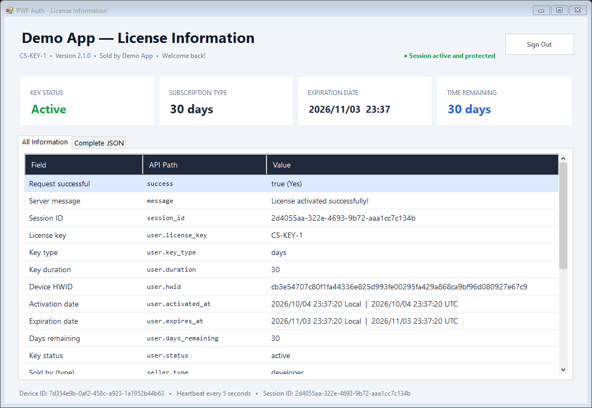
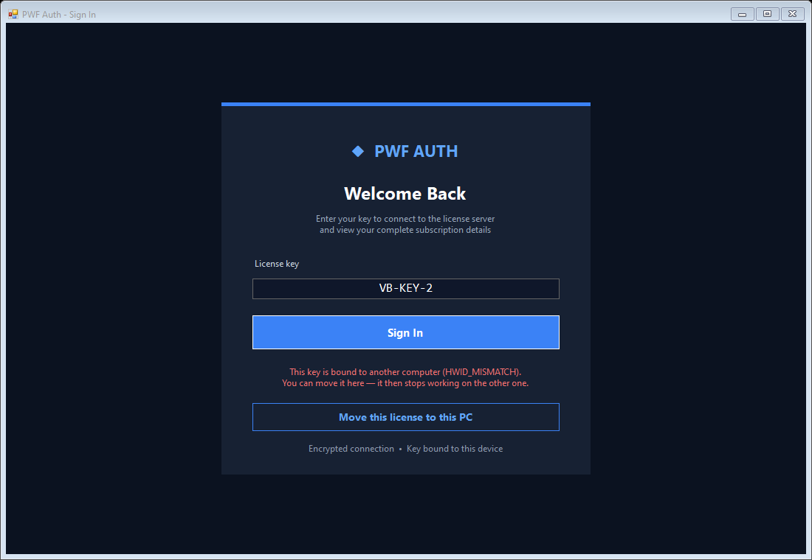

<p align="center"><a href="README.md">English</a> · <a href="README.zh-CN.md">简体中文</a> · <b>Türkçe</b> · <a href="README.ar.md">العربية</a></p>
<p align="center">Video eğitimleri: <a href="https://www.youtube.com/@pwfauth">youtube.com/@pwfauth</a></p>

# PWF Auth C# Masaüstü İstemcisi

Bu sürüm **PWFAuth 1.7.0** kullanır. Depodaki NuGet.Config, doğrulanmış resmi SDK'yı vendor/ klasöründen geri yükler; aynı paket nuget.org'da da bulunur. PWFAuth 1.4.0 ve daha eski sürümler mevcut sunucuyla iletişim kuramaz (sunucu yanıtlarını yeni bir anahtarla imzalar), bu yüzden eski kopyaları güncelleyin

Resmi [`PWFAuth` NuGet paketi](https://www.nuget.org/packages/PWFAuth) (sürüm 1.7.0) için .NET Framework 4.8.1 üzerinde çalışan, İngilizce arayüzlü bir Windows Forms örneği. Uygulama:

- lisans anahtarıyla oturum açar;
- arka planda çalışan düzenli kontrol (heartbeat) ile oturumu açık tutar;
- sunucu oturumu sonlandırdığında oturumu kapatır;
- giriş yanıtının tamamını gösterge panelinde gösterir;
- anahtar için sunucuda bir değer saklar (kullanıcı değişkeni)



## Neler gösteriliyor

- **Lisans anahtarıyla oturum açma.** `LoginAsync`, anahtarı bu bilgisayara bağlar. Ardından gösterge paneli şunları gösterir:
  - anahtarın durumu, türü, bitiş tarihi ve kalan süresi;
  - anahtarı kimin sattığı;
  - yanıttaki her alan
- **Uzaktan durdurma (kill switch).** `StartHeartbeat`, oturum açıldıktan sonra çalışır. Anahtarı panelinizde yasakladığınızda, duraklattığınızda veya sıfırladığınızda ya da anahtarın süresi dolduğunda paket `SessionEnded` olayını tetikler ve uygulama, nedenini göstererek oturum açma sayfasına döner. Olay UI iş parçacığında gelir, bu yüzden `Invoke` gerekmez
- **Lisansı yeni bir bilgisayara taşıma.** Anahtar başka bir bilgisayara bağlıysa oturum açma sayfası **Move this license to this PC** seçeneğini sunar. Bu seçenek `ResetHardwareIdAsync` metodunu çağırır ve ardından yeniden oturum açar. İki taşıma arasında geliştiricinin belirlediği bekleme süresi uygulanır (varsayılan olarak 12 saat)

  

- **Kullanıcı değişkenleri.** Oturum açıldıktan sonra uygulama `sample_opens` değerini okur, bir artırır ve `GetVariableAsync` / `SetVariableAsync` ile kaydeder; başlığın altında "Opened N times with this key" yazısını gösterir ve anahtarın tüm değişkenlerini (`GetVariablesAsync`) ayrıntılar tablosunda listeler. Anahtarı panelinizde açın (**Licences → anahtar → Variables**): sayaç oradadır ve orada değiştirdiğiniz değer, uygulamanın bir sonraki sefer okuyacağı değerdir. Değişkenler anahtarla birlikte yeni bilgisayara taşınır
- **Anlaşılır hata mesajları.** Uygulama şu durumlarda sade bir mesaj gösterir:
  - internet bağlantısı yoksa;
  - sunucu uygulama gizli anahtarını (app secret) reddederse (HTTP 401);
  - `App.config` içindeki gizli anahtar hâlâ yer tutucu değerdeyse
- **Temiz oturum kapatma.** **Sign Out** düğmesi de pencereyi kapatmak da oturumu sunucuda hemen sonlandırır

Paket ayrıca yanlış ayarlanmış bilgisayar saatini kendiliğinden düzeltir ve şifreleme olmadan başarı bildiren yanıtları reddeder

## Gereksinimler

- Windows 10 veya üzeri
- .NET masaüstü geliştirme iş yükü yüklü Visual Studio
- .NET Framework 4.8.1

## Yapılandırma

64 karakterlik uygulama gizli anahtarını `PWFAuthCSharp/App.config` dosyasına yazın:

```xml
<add key="PWFAuthAppSecret" value="YOUR_64_CHARACTER_APP_SECRET" />
```

Gizli anahtarı dağıtımdan önce ayarlayın ve asla depoya commit etmeyin. Uç nokta `https://pwfauth.com` olarak sabittir; ortam değişkenleriyle yapılan geçersiz kılmalar yok sayılır

## Derleme ve çalıştırma

1. `PWFAuthCSharp.slnx` dosyasını Visual Studio'da açın
2. İstendiğinde NuGet paketlerini geri yükleyin
3. `Debug | Any CPU` yapılandırmasını seçin ve `F5` tuşuna basın

Bu örneğin eski bir kopyasından mı yükseltiyorsunuz? `packages` klasöründeki eski sürümün yerini `PWFAuth` 1.7.0'ın alması için NuGet paketlerini bir kez geri yükleyin
